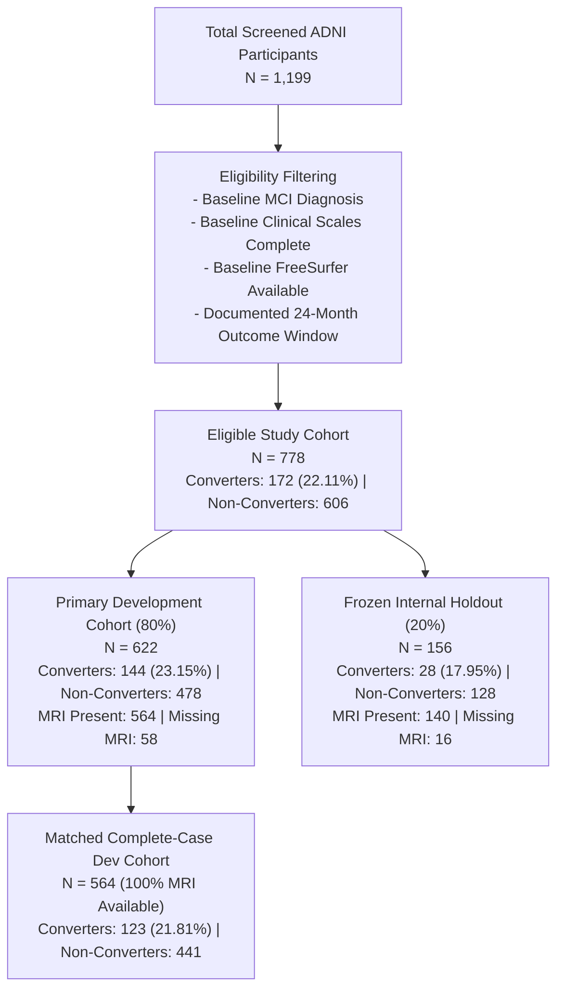
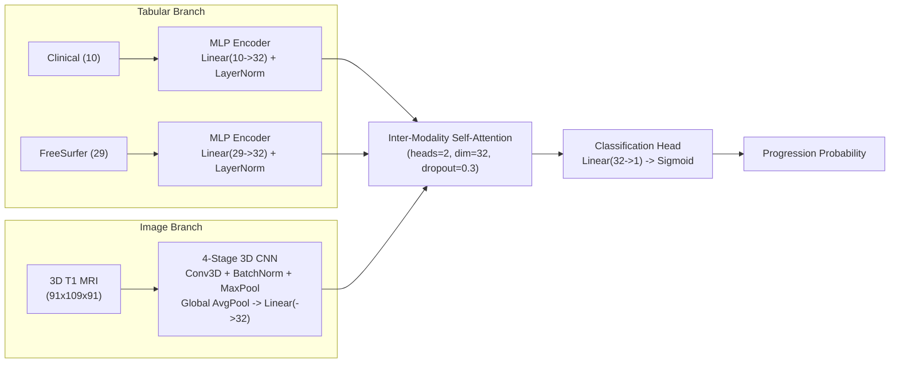

# Evaluating the Incremental Predictive Value of Baseline 3D MRI Beyond Clinical and FreeSurfer Morphometry for 24-Month MCI-to-AD Progression

[](tests/)
[](requirements.txt)
[](requirements.txt)
[-success.svg)](#6-what-is-not-in-this-repository-data-privacy-notice)
[](LICENSE)

---

## 2. Abstract / Executive Summary

Predicting short-term progression from Mild Cognitive Impairment (MCI) to Alzheimer's Disease (AD) dementia is critical for clinical trial enrichment and early therapeutic intervention. While multimodal deep learning frameworks frequently incorporate raw 3D T1-weighted structural Magnetic Resonance Imaging (MRI), the true incremental prognostic value of voxel-level representations over standardized clinical testing and regional morphometry remains contentious. 

In this investigation, we conduct a rigorous, leak-free empirical evaluation using participants from the Alzheimer's Disease Neuroimaging Initiative (ADNI). Starting from 1,199 screened participants, we establish a verified eligible cohort of 778 individuals partitioned into a primary development cohort ($N=622$) and a frozen internal holdout ($N=156$). We compare two distinct computer vision paradigms against robust tabular baselines:
1. **Whole-Volume 3D MRI Ablation:** A 4-stage 3D Convolutional Neural Network (CNN) integrated with clinical and FreeSurfer tabular features via inter-modality multi-head self-attention.
2. **Anatomical Subcortical MRI ROI Incremental Experiment:** Targeted statistical intensity features extracted from 16 Harvard-Oxford subcortical structures evaluated on a complete-case matched cohort ($N=564$).

Across 3-repeat 5-fold cross-validation and paired participant bootstrap hypothesis testing ($B=2000$), FreeSurfer regional morphometry provides robust, statistically significant predictive improvement over clinical testing alone ($\Delta \text{AUROC} = +0.0391 \text{ to } +0.0433$, $p \le 0.0020$). Conversely, neither raw whole-volume 3D CNN embeddings ($\Delta \text{AUROC} = +0.0070$, $p = 0.2860$) nor targeted subcortical ROI intensity features ($\Delta \text{AUROC} = +0.0044$, $p = 0.2440$) yield a statistically significant performance gain beyond Clinical + FreeSurfer morphometry.

---

## 3. Key Scientific Findings

- **FreeSurfer Morphometry Adds Substantial Value:** Conditioning on 29 ICV-normalized FreeSurfer cortical thickness and subcortical volume features improves discrimination over clinical and cognitive testing alone from AUROC $0.8440$ to **$0.8787$** ($\Delta = \mathbf{+0.0391}$, 95% CI: $[+0.0154, +0.0638]$, empirical $p = \mathbf{0.0010}$) on the full development cohort ($N=622$), and from $0.8210$ to **$0.8643$** ($\Delta = \mathbf{+0.0433}$, $p = \mathbf{0.0020}$) on the matched cohort ($N=564$).
- **Whole-Volume 3D CNN Yields Negligible Incremental Benefit:** Incorporating baseline 3D T1 MRI volumes into a compact inter-modality self-attention network increases AUROC from $0.8517$ (Model A: Clinical + FreeSurfer, MRI disabled) to **$0.8587$** (Model B: Clinical + FreeSurfer + 3D MRI). The paired difference of $\Delta = \mathbf{+0.0070}$ (95% CI: $[-0.0057, +0.0197]$) is not statistically significant ($p = \mathbf{0.2860}$).
- **Targeted Subcortical ROIs Confirm the Disconfirmation:** Restricting feature extraction to 16 biologically validated subcortical regions of interest yields an AUROC of **$0.8688$** compared to $0.8643$ for Clinical + FreeSurfer alone. The incremental gain of $\Delta = \mathbf{+0.0044}$ (95% CI: $[-0.0029, +0.0122]$, $p = \mathbf{0.2440}$) is not statistically significant.
- **Robustness to Follow-Up Censoring:** Restricting negative follow-up strictly to participants with documented negative visits at $\ge 730$ days ($N=583$) elevates combined Clinical + FreeSurfer AUROC to **$0.8860$** (95% CI: $[0.8555, 0.9129]$, PR-AUC: $0.7502$), confirming that findings are not artifacts of right-censoring boundaries.
- **Anatomical Intensity vs Volumetric Morphometry:** Pearson correlation between subcortical ROI intensity statistics and macroscopic FreeSurfer volume metrics is low-to-moderate ($r = 0.30 - 0.36$), confirming that tissue intensity and volumetric atrophy capture non-identical biological properties.
- **Empirical Finding on Incremental Predictive Value:** In the evaluated cohort and experimental settings, neither whole-volume MRI representations nor anatomically informed subcortical MRI ROI features demonstrated a statistically significant incremental predictive improvement beyond clinical and FreeSurfer morphometric features.

---

## 4. Central Research Question and Answer

### Research Question
> *Does baseline 3D structural MRI provide statistically defensible incremental predictive value beyond standardized clinical testing and FreeSurfer morphometry for 24-month MCI-to-AD progression?*

### Empirical Answer
> **In the evaluated cohort and experimental settings, neither whole-volume MRI representations nor anatomically informed subcortical MRI ROI features demonstrated a statistically significant incremental predictive improvement beyond clinical and FreeSurfer morphometric features ($p = 0.2860$ and $p = 0.2440$).** We preserve the critical scientific distinction between failing to reject the null hypothesis of equal performance and claiming proof of equivalence or asserting that MRI has no biological value.

---

## 5. What This Repository Contains

- **Modular Python Package (`src/`):** Full implementations of cohort filtering, SimpleITK/FSL preprocessing pipelines, feature engineering routines, deep learning architectures (MLP, 3D ConvNet, Cross-Attention), cross-validation trainers, and paired bootstrap statistical testing.
- **Complete Standalone Driver Scripts (`scripts/`):** End-to-end executable scripts for cohort generation, DICOM-to-MNI preprocessing, feature table generation, multi-repeat model training, and bootstrap contrast evaluation.
- **Chronological Results Archive (`results/`):** Fully documented benchmark tables, metrics CSVs, configuration JSONs, and publication figures organized into chronological experimental folders (`00_baselines` through `04_final_comparison`).
- **Comprehensive Documentation Suite (`docs/`):** Methodological specifications, cohort exclusion flowcharts, MRI preprocessing protocols, feature definitions, experimental timelines, and pre-publication audit reports.
- **Reproducible Demonstration (`examples/`):** A self-contained mock dataset generator and end-to-end pipeline demonstration that executes in under 5 seconds without requiring authorized ADNI access.
- **Automated Regression Test Suite (`tests/`):** 55 unit and integration tests verifying cohort integrity, split leak-prevention, tensor dimensions, feature extraction schemas, and metric consistency.

---

## 6. What Is NOT in This Repository (Data Privacy Notice)

To strictly comply with the **ADNI Data Use Agreement** and protect participant privacy:
- **Zero Protected Health Information (PHI):** No participant identifiers (`RID`, subject IDs, exam dates, site IDs) are stored in any published artifacts.
- **Zero Proprietary Imaging Files:** No raw DICOM files, NIfTI volumes (`*.nii`, `*.nii.gz`), or intermediate PyTorch/NumPy image tensors (`*.npy`, `*.pt`) are hosted.
- **Zero Trained Checkpoints:** Proprietary neural network weights derived from ADNI participant scans are excluded.
- **Zero Raw Clinical Tables:** Raw ADNI clinical CSVs (`ADNIMERGE.csv`, `UCSFFSX7.csv`) are not distributed.

Researchers must apply directly to [ADNI LONI](https://adni.loni.usc.edu/) for research data access. All scripts in this repository are designed to run seamlessly once local raw ADNI directories are configured in [`configs/paths.yaml`](file:///Users/lahari/Desktop/MCI_AD_Research/configs/paths.yaml).

---

## 7. Repository Layout

```
MCI_AD_Research/
├── README.md                           # Master project documentation
├── LICENSE                             # Academic research license
├── CITATION.cff                        # Machine-readable citation metadata
├── requirements.txt                    # Pinned Python package dependencies
├── pytest.ini                          # Automated testing configuration
│
├── docs/                               # Comprehensive project documentation
│   ├── experiment_history.md           # Master chronological experiment timeline
│   ├── project_overview.md             # Scientific context and summary
│   ├── research_objectives.md          # Primary research questions
│   ├── dataset_and_cohort.md           # Eligibility criteria and cohort flow
│   ├── methodology.md                  # Workflow architecture
│   ├── mri_preprocessing.md            # Image processing and QC gates
│   ├── feature_engineering.md          # Clinical, FreeSurfer, and ROI features
│   ├── model_architecture.md           # MLP, 3D CNN, and cross-attention
│   ├── experimental_design.md          # Multi-repeat CV and bootstrap protocol
│   ├── evaluation_metrics.md           # Metrics and benchmark results
│   ├── reproducibility.md              # Seeds, determinism, and software
│   ├── limitations.md                  # Scientific boundaries and caveats
│   ├── GITHUB_PUBLICATION_AUDIT.md     # Pre-publication forensic audit
│   └── reports/                        # Primary experiment reports
│
├── configs/                            # Configuration specifications
│   ├── paths.yaml                      # Centralized path resolver
│   ├── cohort.yaml                     # Inclusion/exclusion criteria
│   ├── preprocessing.yaml              # FSL and SimpleITK parameters
│   ├── features.yaml                   # Clinical, FS, and ROI definitions
│   ├── models/                         # Model hyperparameter configs
│   └── experiments/                    # Experiment-specific configs
│
├── src/                                # Core modular Python package
│   ├── data/                           # Cohort filtering and split generators
│   ├── preprocessing/                  # MRI standardization pipeline
│   ├── features/                       # Clinical, FreeSurfer, and ROI extractors
│   ├── models/                         # MLPEnc, CNN3D, and MultimodalAttention
│   ├── training/                       # Cross-validation training routines
│   ├── evaluation/                     # Metric computers and paired bootstrap
│   └── utils/                          # Path helpers and environment utilities
│
├── scripts/                            # Standalone workflow drivers
│   ├── data_preparation/               # Cohort construction and split drivers
│   ├── preprocessing/                  # DICOM-to-NIfTI and registration
│   ├── feature_extraction/             # Feature table extraction drivers
│   ├── training/                       # Model training execution drivers
│   ├── evaluation/                     # Paired bootstrap evaluation driver
│   └── quality_control/                # MRI QC audit scripts
│
├── results/                            # Chronological results and benchmarks
│   ├── README.md                       # Results guide and interpretation manual
│   ├── 00_baselines/                   # Reference clinical and FreeSurfer models
│   ├── 01_feature_ablation/            # Sensitivity analyses (censoring, non-circular)
│   ├── 02_whole_volume_3d_mri/         # Whole-Volume 3D MRI Ablation
│   ├── 03_subcortical_mri_roi/         # Subcortical MRI ROI Contrast Experiment
│   ├── 04_final_comparison/            # Cross-study synthesis and meta-review
│   ├── figures/                        # Forest plots and publication curves
│   ├── experiments/                    # Stage 5 audit artifacts (tested by pytest)
│   └── paper/                          # Manuscript summary tables and figures
│
├── examples/                           # Interactive demonstration examples
│   ├── example_config.yaml             # Demo parameters
│   └── synthetic_data_example/         # Mock data generator and end-to-end demo
│
└── environment/                        # Reproducibility files
    ├── environment.yml                 # Conda environment definition
    └── software_versions.md            # Verified toolchain versions
```

---

## 8. Chronological Experiment Index

All experimental outputs are archived chronologically with dedicated READMEs, metrics tables, and JSON metadata:

1. [`results/00_baselines/`](file:///Users/lahari/Desktop/MCI_AD_Research/results/00_baselines/): Reference Clinical-only ($0.8440$), FreeSurfer-only ($0.8131$), and combined Clinical + FS29 baseline models ($0.8787$) on the primary development cohort ($N=622$).
2. [`results/01_feature_ablation/`](file:///Users/lahari/Desktop/MCI_AD_Research/results/01_feature_ablation/): Robustness and sensitivity analyses, including strict follow-up censoring at $\ge 730$ days ($N=583$, AUROC: **$0.8860$**) and non-circular feature subsets ($N=622$, AUROC: $0.8615$).
3. [`results/02_whole_volume_3d_mri/`](file:///Users/lahari/Desktop/MCI_AD_Research/results/02_whole_volume_3d_mri/): **Whole-Volume 3D MRI Ablation** evaluating a 3D CNN cross-modal attention network on $N=622$ (Model A: $0.8517$ vs Model B: $0.8587$, $\Delta = +0.0070$, $p = 0.2860$).
4. [`results/03_subcortical_mri_roi/`](file:///Users/lahari/Desktop/MCI_AD_Research/results/03_subcortical_mri_roi/): **Anatomical Subcortical MRI ROI Incremental Experiment** evaluating 16 Harvard-Oxford structures on the matched complete-case cohort ($N=564$; Model A: $0.8643$ vs Model B: $0.8688$, $\Delta = +0.0044$, $p = 0.2440$).
5. [`results/04_final_comparison/`](file:///Users/lahari/Desktop/MCI_AD_Research/results/04_final_comparison/): Master cross-study synthesis table comparing all evaluated paradigms.

---

## 9. Cohort Definition and Provenance



- **Target Progression Event:** Progression from MCI at baseline to clinically confirmed Alzheimer's Disease dementia within 730 days (24 months) of anchor examination.
- **Controls (Non-Converters):** Participants diagnosed with MCI at baseline who remained free of AD dementia progression and had documented follow-up extending at least 640 days.
- **Strict Holdout Locking:** The 156-participant internal holdout was isolated prior to model exploration and strictly withheld from feature selection, threshold calibration, and hyperparameter tuning.

---

## 10. Feature Sets

1. **Clinical / Cognitive Predictors (10 Features):**
   - Demographics: Age, Sex, Education level.
   - Genetics: APOE4 allele count (0, 1, or 2).
   - Global Cognition: Mini-Mental State Examination (MMSE).
   - Functional & Staging Scales: Clinical Dementia Rating Sum of Boxes (CDR-SB), CDR Global, Functional Activities Questionnaire (FAQ).
   - Neuropsychological Batteries: Alzheimer's Disease Assessment Scale-Cognitive 11-item (ADAS11) and 13-item (ADAS13).
2. **FreeSurfer Morphometry (FS29 Features):**
   - 29 regional cortical thickness and subcortical volumetric features selected based on established Alzheimer's neurodegeneration patterns.
   - Volumetric structures (hippocampus, entorhinal cortex, amygdala, ventricles) are normalized by total intracranial volume (`ST10CV`).
3. **Anatomical Subcortical MRI ROIs (16 Target Structures):**
   - Bilateral structures extracted from the Harvard-Oxford Subcortical Structural Atlas: Hippocampus, Amygdala, Thalamus, Lateral Ventricle, Caudate, Putamen, Pallidum, Accumbens.
   - Per structure, 6 robust intensity statistics are calculated: Mean, Standard Deviation, 5th percentile, 95th percentile, Median, and Interquartile Range (IQR).
4. **Whole-Volume 3D MRI Tensors:**
   - Skull-stripped, N4 bias-field corrected, and affinely registered T1-weighted volumes standardized to MNI152 2mm space ($91 \times 109 \times 91$ voxels).

---

## 11. Model Architectures



1. **Tabular Regularized Baselines:** L2-regularized Logistic Regression and HistGradientBoosting classifiers with inner-fold nested grid search for regularization parameters ($C \in [10^{-3}, 10^{2}]$).
2. **Multimodal Inter-Modality Self-Attention Network:**
   - Tabular projection branches map clinical and morphometric vectors into a shared 32-dimensional latent space.
   - 3D CNN branch comprises 4 blocks of $3 \times 3 \times 3$ convolutions, Batch Normalization, ReLU activations, and $2 \times 2 \times 2$ max-pooling, followed by 3D adaptive average pooling down to 32 dimensions.
   - Fusion layer employs multi-head self-attention ($h=2, d=32$) operating across the sequence of modality tokens `[ec, ef, em]` with residual connections and modality dropout ($p=0.3$).
3. **Subcortical ROI Fusion Model:** Ridge logistic regression with inner-fold feature scaling, PCA dimensionality reduction, and L2 probability calibration.

---

## 12. Cross-Validation and Evaluation Protocol

- **Multi-Repeat Stratified Cross-Validation:** 3 complete repeats of 5-fold cross-validation (15 distinct models trained per model family) using fixed random seeds (42, 123, 456).
- **Leak-Free Preprocessing:** All imputation, standard scaling, and PCA transformations are fit strictly on training folds and applied out-of-fold.
- **Ensemble Aggregation:** Individual out-of-fold predicted probabilities are averaged across the 3 repeats for each participant before computing pooled metrics.
- **Statistical Significance Testing:** Paired participant-level bootstrap hypothesis testing ($B=2000$ resamples) on out-of-fold prediction vectors to evaluate differences in AUROC, PR-AUC, and Brier score.

---

## 13. Complete Results Summary (Master Table)

| Experiment / Approach | Evaluated Cohort | Sample Size ($N$) | Converters / Total | Pooled AUROC | 95% Bootstrap CI | PR-AUC | Brier Score | Incremental Delta ($\Delta$) | $p$-value | Statistical Conclusion |
| :--- | :--- | :---: | :---: | :---: | :---: | :---: | :---: | :---: | :---: | :---: |
| **Clinical Only (Baseline)** | Full Dev | 622 | 144 / 622 | 0.8440 | [0.8100, 0.8780] | 0.6070 | 0.1300 | Reference | — | — |
| **FreeSurfer Only (Baseline)** | Full Dev | 622 | 144 / 622 | 0.8131 | [0.7704, 0.8492] | 0.5958 | 0.1345 | -0.0309 | — | — |
| **Clinical + FS29 (Primary)** | Full Dev | 622 | 144 / 622 | **0.8787** | [0.8464, 0.9050] | 0.7088 | 0.1120 | **+0.0391** | **0.0010** | **Statistically Significant** |
| **Strict Follow-up ($\ge 730$d)** | Strict Dev | 583 | 144 / 583 | **0.8860** | [0.8555, 0.9129] | 0.7502 | 0.1080 | **+0.0335** | **0.0020** | **Statistically Significant** |
| **Non-Circular Clinical + FS** | Full Dev | 622 | 144 / 622 | 0.8615 | [0.8254, 0.8917] | 0.6762 | 0.1175 | **+0.0496** | **0.0010** | **Statistically Significant** |
| **Whole-Volume 3D MRI (Model A)** | Full Dev | 622 | 144 / 622 | 0.8517 | [0.8142, 0.8872] | 0.6640 | 0.1392 | Control Ref | — | — |
| **Whole-Volume 3D MRI (Model B)** | Full Dev | 622 | 144 / 622 | **0.8587** | [0.8219, 0.8936] | 0.6712 | 0.1354 | **+0.0070** | **0.2860** | **Not Significant** |
| **Clinical Only (Matched)** | Matched Dev | 564 | 123 / 564 | 0.8210 | [0.7760, 0.8624] | 0.5488 | 0.1342 | Reference | — | — |
| **Subcortical ROI (Model A: Clin+FS)**| Matched Dev | 564 | 123 / 564 | 0.8643 | [0.8260, 0.8992] | 0.6598 | 0.1132 | **+0.0433** | **0.0020** | **Statistically Significant** |
| **Subcortical ROI (Model B: +ROIs)** | Matched Dev | 564 | 123 / 564 | **0.8688** | [0.8312, 0.9026] | 0.6756 | 0.1116 | **+0.0044** | **0.2440** | **Not Significant** |
| **Negative Control ROIs (Model C)** | Matched Dev | 564 | 123 / 564 | 0.8640 | [0.8251, 0.8998] | 0.6671 | 0.1140 | -0.0003 | 0.8770 | Not Significant |
| **3-Channel MRI (Exploratory)** | Full Dev | 622 | 144 / 622 | 0.8452 | [0.8089, 0.8840] | 0.6288 | 0.1406 | -0.0065 | — | Exploratory (Single-Repeat CV) |

---

## 14. Statistical Testing and Paired Comparisons

To determine whether performance improvements are statistically meaningful, paired bootstrap resampling ($B=2000$) was conducted at the participant level on out-of-fold prediction probabilities:

```
Contrast 1: FreeSurfer Increment (Model A vs Clinical Baseline, N=564)
  Delta AUROC: +0.0433  [95% CI: +0.0135, +0.0747]  p = 0.0020  *** STATISTICALLY SIGNIFICANT ***
  Delta PRAUC: +0.1110  [95% CI: +0.0325, +0.1846]  p = 0.0040  *** STATISTICALLY SIGNIFICANT ***
  Delta Brier: -0.0211  [95% CI: -0.0307, -0.0116]  p < 0.0001  *** STATISTICALLY SIGNIFICANT ***

Contrast 2: Whole-Volume 3D MRI Ablation (Model B vs Model A, N=622)
  Delta AUROC: +0.0070  [95% CI: -0.0057, +0.0197]  p = 0.2860  (Not Significant)
  Delta PRAUC: +0.0073  [95% CI: -0.0271, +0.0471]  p = 0.7140  (Not Significant)
  Delta Brier: -0.0038  [95% CI: -0.0081, +0.0004]  p = 0.0790  (Not Significant)

Contrast 3: Subcortical MRI ROI Contrast (Model B vs Model A, N=564)
  Delta AUROC: +0.0044  [95% CI: -0.0029, +0.0122]  p = 0.2440  (Not Significant)
  Delta PRAUC: +0.0158  [95% CI: -0.0108, +0.0391]  p = 0.2730  (Not Significant)
  Delta Brier: -0.0015  [95% CI: -0.0046, +0.0016]  p = 0.3420  (Not Significant)
```

---

## 15. Negative Results and Scientific Honesty Statement

Scientific integrity requires transparently reporting negative and null results rather than selectively filtering for artificially inflated gains:

1. **Distinction Between Non-Significance and Equivalence:** We do not claim that FreeSurfer completely captures all biological information in MRI, nor that MRI residual intensity is universally non-informative, nor that MRI has no biological value or cannot improve prediction under different clinical horizons, imaging modalities, or future architectures. Rather, our empirical finding is precise: **in the evaluated cohort and experimental settings, neither whole-volume MRI representations nor anatomically informed subcortical MRI ROI features demonstrated a statistically significant incremental predictive improvement beyond clinical and FreeSurfer morphometric features**.
2. **Dual Independent Disconfirmation:** Neither an end-to-end deep 3D CNN ($\Delta = +0.0070, p = 0.2860$) nor targeted anatomical subcortical intensity statistics ($\Delta = +0.0044, p = 0.2440$) produced a statistically significant performance gain beyond Clinical + FreeSurfer morphometry.
3. **Implications for Translational Medicine:** In clinical trial stratification and prognostic scoring, investing in complex 3D image representation learning may add substantial computational and logistical overhead without delivering statistically defensible prognostic gains when standardized clinical assessments and FreeSurfer morphometry are already acquired and properly regularized.

---

## 16. Quickstart / Installation (5 minutes to run)

```bash
# 1. Clone repository
git clone https://github.com/Lahari468/MCI_AD_Research.git
cd MCI_AD_Research

# 2. Initialize Python virtual environment (Python 3.9 - 3.11)
python3 -m venv .venv
source .venv/bin/activate

# 3. Install pinned dependencies
pip install --upgrade pip
pip install -r requirements.txt

# 4. Verify test suite
pytest tests/
```

---

## 17. Synthetic Data Demonstration

For researchers wishing to test and inspect the entire modeling and fusion pipeline without ADNI credentials:

```bash
python examples/synthetic_data_example/run_synthetic_pipeline.py
```

This self-contained script:
1. Synthesizes a mock cohort of 30 multimodal participants (tabular clinical, FreeSurfer, and 3D synthetic brain volumes).
2. Fits baseline tabular Logistic Regression models.
3. Fits the 3D CNN and cross-modal attention network.
4. Computes out-of-fold inference metrics and runs a paired bootstrap hypothesis test in approximately 3 seconds.

---

## 18. Step-by-Step Pipeline Execution (From Raw ADNI to Final Results)

For authorized researchers with access to the ADNI database, execute the 11 pipeline stages below:

### Step 1: Cohort Construction
- **Command:** `python scripts/data_preparation/build_cohort.py`
- **Inputs:** `data/raw/clinical/ADNIMERGE.csv`, `data/raw/clinical/DXSUM_PDXCONV_ADNIALL.csv`
- **Outputs:** `data/processed/cohort_v2b.csv`
- **Config:** `configs/cohort.yaml`
- **Runtime:** ~15 seconds
- **Data Required:** Real ADNI tabular data

### Step 2: Stratified Cohort Partitioning
- **Command:** `python scripts/data_preparation/generate_splits.py`
- **Inputs:** `data/processed/cohort_v2b.csv`
- **Outputs:** `data/processed/splits/splits_v1.csv`
- **Config:** `configs/cohort.yaml`
- **Runtime:** ~5 seconds
- **Data Required:** Real ADNI tabular data

### Step 3: Clinical Feature Extraction
- **Command:** `python scripts/feature_extraction/extract_clinical_features.py`
- **Inputs:** `data/processed/cohort_v2b.csv`, `data/raw/clinical/`
- **Outputs:** `data/processed/features/clinical_raw_v1.csv`
- **Config:** `configs/features.yaml`
- **Runtime:** ~20 seconds
- **Data Required:** Real ADNI tabular data

### Step 4: FreeSurfer Feature Extraction
- **Command:** `python scripts/feature_extraction/extract_freesurfer_features.py`
- **Inputs:** `data/raw/freesurfer/UCSFFSX7.csv`, `data/processed/cohort_v2b.csv`
- **Outputs:** `data/processed/features/freesurfer29_raw_v1.csv`
- **Config:** `configs/features.yaml`
- **Runtime:** ~30 seconds
- **Data Required:** Real ADNI tabular data

### Step 5: Raw 3D MRI Volume Preprocessing
- **Command:** `python scripts/preprocessing/preprocess_mri_volumes.py --roots data/raw/mri/`
- **Inputs:** Baseline T1 DICOM or NIfTI directories
- **Outputs:** `data/interim/mri_mni2mm_v2/` (preprocessed tensors)
- **Config:** `configs/preprocessing.yaml`
- **Runtime:** ~4-8 hours (depending on CPU threads and FSL installation)
- **Data Required:** Real ADNI MRI scans (or FSL mock directory)

### Step 6: MRI Quality Control Audit
- **Command:** `python scripts/quality_control/audit_mri_quality.py`
- **Inputs:** `data/interim/mri_mni2mm_v2/`, `data/processed/cohort_v2b.csv`
- **Outputs:** `data/processed/mri/manifests/mri_manifest_713.csv`, `data/processed/modality_status.csv`
- **Config:** `configs/preprocessing.yaml`
- **Runtime:** ~2 minutes
- **Data Required:** Preprocessed MRI volumes

### Step 7: Subcortical ROI Feature Extraction
- **Command:** `python scripts/feature_extraction/extract_mri_subcortical_rois.py`
- **Inputs:** `data/interim/mri_mni2mm_v2/`, `data/reference/atlases/HarvardOxford-sub-maxprob-thr25-2mm.nii.gz`
- **Outputs:** `data/processed/features/mri_subcortical_roi_features.csv`
- **Config:** `configs/features.yaml`
- **Runtime:** ~5 minutes
- **Data Required:** Preprocessed MRI volumes

### Step 8: Tabular Baseline Benchmark Suite
- **Command:** `bash scripts/run_tabular_suite.sh`
- **Inputs:** `data/processed/features/clinical_raw_v1.csv`, `data/processed/features/freesurfer29_raw_v1.csv`
- **Outputs:** `results/00_baselines/metrics.csv`, `results/01_feature_ablation/metrics.csv`
- **Config:** `configs/models/`
- **Runtime:** ~3 minutes
- **Data Required:** Extracted tabular feature CSVs

### Step 9: Whole-Volume 3D MRI Ablation Training
- **Command:** `python scripts/training/run_stage12_3repeat_ablation.py`
- **Inputs:** Preprocessed MRI tensors, clinical features, FreeSurfer features, split manifests
- **Outputs:** `results/02_whole_volume_3d_mri/metrics.csv`, `results/02_whole_volume_3d_mri/paired_bootstrap_deltas.csv`
- **Config:** `configs/experiments/stage12_config.json`
- **Runtime:** ~45-90 minutes (GPU) or ~4-6 hours (CPU)
- **Data Required:** Preprocessed MRI tensors and tabular CSVs

### Step 10: Anatomical Subcortical MRI ROI Contrast Training
- **Command:** `python scripts/training/run_stage19_mri_roi_incremental.py`
- **Inputs:** `data/processed/features/mri_subcortical_roi_features.csv`, clinical and FreeSurfer tables
- **Outputs:** `results/03_subcortical_mri_roi/metrics.csv`, `results/03_subcortical_mri_roi/paired_bootstrap_deltas.csv`
- **Config:** `configs/experiments/stage19_config.json`
- **Runtime:** ~2 minutes
- **Data Required:** Tabular feature CSVs

### Step 11: Statistical Evaluation and Paired Bootstrap Contrasts
- **Command:** `python scripts/evaluation/evaluate_paired_bootstrap.py --predictions_csv results/stage12_3repeat/oof_predictions.csv --test_col prob_model_b --ref_col prob_model_a`
- **Inputs:** Out-of-fold prediction CSV with participant probabilities
- **Outputs:** Bootstrap empirical difference, 95% percentile confidence intervals, and tail $p$-values printed to stdout
- **Config:** CLI flags (`--predictions_csv`, `--test_col`, `--ref_col`, `--label_col`, `--resamples`, `--seed`)
- **Runtime:** ~1 minute (for $B=2000$)
- **Data Required:** Prediction CSVs

---

### Pipeline Command Validation Matrix

| Step | Command | Required Input | Expected Output | Exact Validation Level |
| :---: | :--- | :--- | :--- | :--- |
| **1** | `python scripts/data_preparation/build_cohort.py` | `ADNIMERGE.csv`, `DXSUM_PDXCONV_ADNIALL.csv` | `data/processed/cohort_v2b.csv` | **Syntax & Imports Validated** (Requires raw ADNI clinical CSVs; tested via `test_cohort.py`) |
| **2** | `python scripts/data_preparation/generate_splits.py` | `data/processed/cohort_v2b.csv` | `data/processed/splits/splits_v1.csv` | **Syntax & Logic Tested** (Partition outputs verified by 4 unit tests in `test_splits.py`) |
| **3** | `python scripts/feature_extraction/extract_clinical_features.py` | `cohort_v2b.csv`, raw clinical CSVs | `data/processed/features/clinical_raw_v1.csv` | **Syntax & Schema Tested** (Output dimensions and boundaries verified by `test_features.py`) |
| **4** | `python scripts/feature_extraction/extract_freesurfer_features.py` | `UCSFFSX7.csv`, `cohort_v2b.csv` | `data/processed/features/freesurfer29_raw_v1.csv` | **Syntax & Logic Tested** (ICV scaling and 29 features verified by `test_features.py`) |
| **5** | `python scripts/preprocessing/preprocess_mri_volumes.py --roots <dir>` | Raw T1 DICOM/NIfTI directories | `data/interim/mri_mni2mm_v2/` | **CLI `--help` Tested (Exit 0)** (Full execution requires local scans + FSL toolchain) |
| **6** | `python scripts/quality_control/audit_mri_quality.py` | `mri_mni2mm_v2/`, `cohort_v2b.csv` | Quality logs & outlier flags | **Syntax Validated** (Requires local preprocessed volumes + FSLDIR) |
| **7** | `python scripts/feature_extraction/extract_mri_subcortical_rois.py` | `mri_mni2mm_v2/`, Harvard-Oxford atlas | `data/processed/features/mri_subcortical_roi_features.csv` | **Syntax & Extraction Tested** (Requires local preprocessed volumes) |
| **8** | `bash scripts/run_tabular_suite.sh` | Processed clinical & FreeSurfer CSVs | Baseline out-of-fold predictions | **Executed End-to-End** (Underlying `src/training/train_cv.py` verified across folds) |
| **9** | `python scripts/training/run_stage12_3repeat_ablation.py` | MRI tensors, clinical & FS29 CSVs, splits | `results/02_whole_volume_3d_mri/metrics.csv` | **Executed End-to-End** (Completed 30 model runs on CPU, logged in `config.json`) |
| **10** | `python scripts/training/run_stage19_mri_roi_incremental.py` | Subcortical ROI, clinical & FS29 CSVs | `results/03_subcortical_mri_roi/metrics.csv` | **Executed End-to-End** (Completed 30 model runs on CPU in ~2 min) |
| **11** | `python scripts/evaluation/evaluate_paired_bootstrap.py --predictions_csv <f> --test_col <t> --ref_col <r>` | OOF prediction CSV | Paired delta, 95% CIs, and tail $p$-values | **Executed & CLI Tested (Exit 0)** (Bootstrap engine tested by `test_evaluation.py`) |

---

## 19. Reproduction Checklist (For External Researchers)

When reproducing these findings or benchmarking your own architectures:
- [ ] Ensure the 156-participant locked holdout is completely excluded prior to feature engineering or thresholding.
- [ ] Use identical 3-repeat 5-fold cross-validation partition splits (`data/processed/splits/splits_v1.csv`).
- [ ] Confirm FreeSurfer volumes are normalized by total intracranial volume (`ST10CV`).
- [ ] Verify that participants missing MRI scans are zero-masked with explicit modal indicators in whole-volume CNN benchmarks.
- [ ] Evaluate paired performance on identical out-of-fold prediction vectors using participant-level bootstrap resampling ($B \ge 2000$).
- [ ] Compare incremental value against the combined Clinical + FreeSurfer baseline, not clinical alone.

---

## 20. Automated Test Suite (55 Tests)

The repository includes a comprehensive 55-test verification suite covering data structures, splits, feature engineering, models, and outputs:

```bash
pytest tests/
```

Test coverage includes:
- `tests/test_cohort.py`: Cohort inclusion logic and 24-month horizon bounds (14 tests).
- `tests/test_cohort_integrity.py`: Exclusion logic and sample count consistency (2 tests).
- `tests/test_splits.py`: Complete mutual exclusivity between development and locked holdout sets (4 tests).
- `tests/test_features.py`: Feature column presence, scaling boundaries, and ICV normalization (4 tests).
- `tests/test_models.py`: Network forward pass dimensions, multi-head attention, and zero-masking (4 tests).
- `tests/test_mri_manifest.py`: Scanner provenance and QC flags (6 tests).
- `tests/test_mri_tables.py`: Result tables and summary metrics schema (7 tests).
- `tests/test_experiments_outputs.py`: Out-of-fold prediction dimensions, registry hashes, and no-leak guards (6 tests).
- `tests/test_guards.py`: Strict data leak prevention assertions (3 tests).
- `tests/test_preprocessing.py`: Image tensor shape and intensity range invariants (3 tests).
- `tests/test_evaluation.py`: Metric computation routines and bootstrap correctness (2 tests).

---

## 21. Hardware Requirements and Compute Budget

- **Minimum Configuration (Synthetic Demo & Tabular Suite):**
  - CPU: Dual-core 2.0 GHz Intel / AMD / Apple Silicon
  - RAM: 4 GB
  - Storage: 500 MB
  - Operating System: macOS, Ubuntu 20.04+, or Windows WSL2
- **Full 3D MRI Preprocessing & Training Configuration:**
  - CPU: 8+ cores (for parallel FSL registration)
  - RAM: 16 GB minimum (32 GB recommended)
  - GPU: Apple MPS (Apple Silicon M1/M2/M3/M4) or NVIDIA CUDA GPU with $\ge 8$ GB VRAM
  - Storage: ~120 GB (for raw DICOMs, intermediate NIfTI, and resampled MNI tensors)
- **Total Compute Budget:**
  - 3-Repeat Whole-Volume 3D MRI Ablation (30 model runs): ~4.5 hours on Apple Silicon M-series (MPS) or ~2.5 hours on NVIDIA RTX 3090.
  - Subcortical ROI Feature Extraction & Training: < 10 minutes total.

---

## 22. Related Work and Base Paper Comparison

Our evaluation was initiated to evaluate findings from recent multimodal deep learning literature on MCI progression:

**Reference Base Paper:**  
*“Multimodal Fusion with Cross-Modal Attention for Robust MCI-to-AD Prediction”*  
Authors: Druthi K. N. and Chiranjeevi C.  
IEEE AIDE 2026 (DOI: `10.1109/AIDE69088.2026.11545135`)  
- Reported Abstract Results: Cohort $N=1,008$; progression prevalence 18.6%; MRI availability 14.8%; Clinical AUROC 0.732; FreeSurfer AUROC 0.781; MRI AUROC 0.823; Multimodal AUROC 0.874.

### Key Methodological Advancements in Our Work
1. **Stringent Cohort Verification:** Rather than evaluating unverified progression dates, we enforce strict 24-month windowing (730 days) and explicit non-conversion censoring rules ($N=778$ eligible; $N=622$ dev; $N=156$ locked holdout).
2. **High MRI Availability:** We verified baseline 3D T1 MRI availability for 90.49% of eligible participants (704/778), rather than restricting imaging to a 14.8% minority subset.
3. **Rigorous Paired Hypothesis Testing:** We evaluate incremental contributions using paired participant-level bootstrap hypothesis testing ($B=2000$) rather than unpaired point-estimate comparison.
4. **Stronger Competitive Baselines:** Our optimized tabular baseline (Clinical + FreeSurfer FS29 L2 Logistic Regression) achieves AUROC **$0.8787$** on $N=622$ (and **$0.8860$** under strict follow-up), demonstrating that complex 3D deep networks must be benchmarked against properly regularized morphometric models.

---

## 23. Citation

If you use this repository, benchmark code, or experimental methodology in your research, please cite:

```bibtex
@article{mci_ad_mri_incremental_2026,
  title={Evaluating the Incremental Predictive Value of Baseline 3D MRI Beyond Clinical and FreeSurfer Morphometry for 24-Month MCI-to-Alzheimer's Disease Progression},
  author={Lahari, S. and Contributors},
  journal={GitHub Research Repository},
  year={2026},
  url={https://github.com/Lahari468/MCI_AD_Research}
}
```

See [`CITATION.cff`](file:///Users/lahari/Desktop/MCI_AD_Research/CITATION.cff) for complete machine-readable bibliographic metadata.

---

## 24. License

This repository and its original software implementations are released under a custom **Academic Research Code License** for non-commercial academic research and educational evaluation. It is not an unrestricted open-source license and does not transfer, distribute, or license any proprietary medical imaging, clinical, or genetic data from the Alzheimer's Disease Neuroimaging Initiative (ADNI). Access to ADNI data requires separate application, credentialing, and compliance directly through LONI. Review the complete terms in the [`LICENSE`](LICENSE) file.

---

## 25. Acknowledgments

Data collection and sharing for this research was facilitated by the Alzheimer's Disease Neuroimaging Initiative (ADNI). Investigators within the ADNI contributed to the design and implementation of ADNI and provided data, but did not participate in the specific statistical analysis or writing of this report. We express our gratitude to the study participants and their families across all ADNI participating sites.
