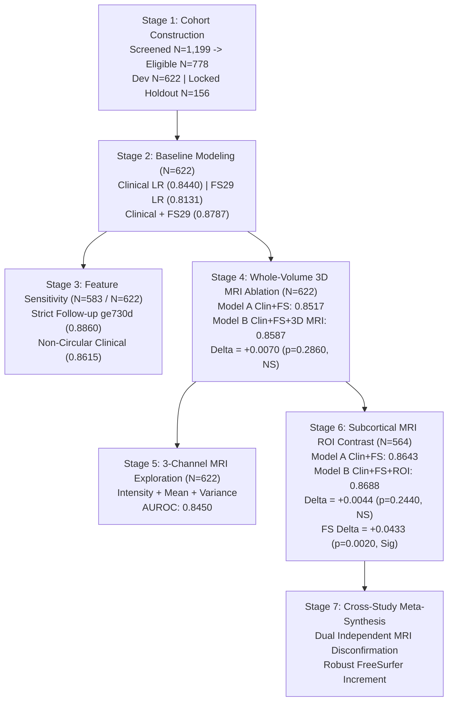

# Master Experiment Timeline and Chronological Provenance

This document chronicles the complete experimental progression of the research project:

> **Evaluating the Incremental Predictive Value of Baseline 3D MRI Beyond Clinical and FreeSurfer Morphometry for 24-Month MCI-to-Alzheimer's Disease Progression.**

Every model, evaluation metric, cohort subset, and hypothesis test is traced back to its raw experimental provenance in the repository.

---

## 1. Experimental Progression Overview

---

## 2. Detailed Chronological Stages

### Stage 1 — Cohort Screening, Eligibility, and Partitioning
- **Source Files:** `data/processed/cohort_v2b.csv`, `data/processed/splits/splits_v1.csv`
- **Starting Sample:** 1,199 screened ADNI participants across ADNI1, ADNIGO, and ADNI2.
- **Eligibility Criteria:**
  1. Baseline diagnosis of Mild Cognitive Impairment (MCI: LMCI or EMCI).
  2. Complete baseline clinical assessment (MMSE, CDR, FAQ, ADAS-Cog).
  3. Quality-checked baseline FreeSurfer morphometry.
  4. Documented clinical outcome within the 24-month horizon (progression to AD or confirmed stability $\ge 640$ days).
- **Eligible Cohort:** 778 participants (172 converters [22.11%], 606 non-converters).
- **Cohort Partitioning:** Prespecified, stratified 80/20 train/test split:
  - **Development Cohort ($N=622$):** 144 converters (23.15%), 478 non-converters.
  - **Locked Internal Holdout ($N=156$):** 28 converters (17.95%), 128 non-converters.
- **MRI Availability:** 704/778 eligible participants (90.49%) had verified baseline 3D T1-weighted MRI scans (564/622 in development, 140/156 in holdout).

---

### Stage 2 — Baseline Tabular Modeling ($N=622$)
- **Source Files:** `results/00_baselines/metrics.csv`, `results/deep/lr_full_clinonly/summary.csv`, `results/paper/T2_dev_cv_models.csv`
- **Objective:** Establish rigorous non-deep learning benchmarks using standard clinical measures and FreeSurfer morphometry.

#### 1. Clinical-Only Logistic Regression (10 Features)
- **Features:** Age, sex, education, APOE4 allele count, MMSE, CDR-SB, CDR Global, FAQ, ADAS11, ADAS13.
- **Single 5-Fold CV (Repeat 0):** AUROC = **$0.8426$** ($0.843 \pm 0.024$).
- **3-Repeat 5-Fold CV:** Repeat mean AUROC = $0.834 \pm 0.018$; pooled repeat-averaged AUROC = **$0.8440$** (95% CI: $[0.8100, 0.8780]$), PR-AUC = 0.6070, Brier = 0.1300.

#### 2. FreeSurfer-Only Logistic Regression (29 Features)
- **Features:** 29 cortical thickness and subcortical volume features normalized by total intracranial volume (`ST10CV`).
- **Performance:** 5-fold CV AUROC = **$0.8131$** (95% CI: $[0.7704, 0.8492]$), PR-AUC = 0.5958, Brier = 0.1345.

#### 3. Combined Clinical + FreeSurfer FS29 Benchmark
- **Initial Single 5-Fold CV (Repeat 0):** AUROC = **$0.8632$** (PR-AUC = 0.6690, Brier = 0.1160).
- **Primary 3-Repeat 5-Fold CV Ensemble (15 Models Pooled):**
  - Repeat mean AUROC: $0.876 \pm 0.006$.
  - Pooled repeat-averaged AUROC: **$0.8787$** (95% CI: $[0.8464, 0.9050]$).
  - PR-AUC: **$0.7088$**, Brier Score: **$0.1120$**, Log-Loss: **$0.3550$**.
  - **Incremental Delta over Clinical:** $\Delta = \mathbf{+0.0391}$ (95% CI: $[+0.0154, +0.0638]$, $p = 0.0010$).

---

### Stage 3 — Feature Ablation and Sensitivity Analysis
- **Source Files:** `results/01_feature_ablation/metrics.csv`, `results/sensitivity_lr.csv`

#### 1. Strict Follow-Up Censoring Analysis ($N=583$)
- **Investigation:** In the development cohort ($N=622$), 39 non-converters were last evaluated between 640 and 729 days. To verify that right-censoring did not inflate performance, these 39 participants were excluded ($N=583$, 144 converters, 439 non-converters).
- **Results:**
  - Clinical Only AUROC: **$0.8525$**
  - Clinical + FS29 AUROC: **$0.8860$** (95% CI: $[0.8555, 0.9129]$)
  - Incremental FreeSurfer Delta: $\Delta = \mathbf{+0.0335}$ (95% CI: $[+0.0070, +0.0595]$, $p = 0.0020$)
  - PR-AUC: **$0.7502$**
- **Conclusion:** Performance is robust to censoring thresholds; discrimination increases to $0.8860$ under strict negative visit criteria.

#### 2. Non-Circular Clinical Feature Sensitivity ($N=622$)
- **Investigation:** CDR-SB, CDR Global, and FAQ overlap conceptually with dementia diagnosis. Models were retrained using only 7 non-diagnostic clinical markers (Age, Sex, Education, APOE4, MMSE, ADAS11, ADAS13).
- **Results:**
  - Non-Circular Clinical Alone: AUROC = **$0.8119$**
  - Non-Circular Clinical + FS29: AUROC = **$0.8615$** (95% CI: $[0.8254, 0.8917]$)
  - FreeSurfer Increment: $\Delta = \mathbf{+0.0496}$ (95% CI: $[+0.0210, +0.0782]$)
- **Conclusion:** FreeSurfer morphometry compensates strongly when functional scales are omitted.

#### 3. Diagnostic Reverters and Early Converters
- Excluding diagnostic reverters ($N=547$): AUROC = **$0.8655$** ($\Delta = +0.0519$).
- Excluding early converters ($\le 180$ days, $N=610$): AUROC = **$0.8698$** ($\Delta = +0.0370$).
- Extended 820-day horizon ($N=622$): AUROC = **$0.8762$** ($\Delta = +0.0376$).

---

### Stage 4 — Whole-Volume 3D MRI Ablation ($N=622$)
- **Source Files:** `results/02_whole_volume_3d_mri/metrics.csv`, `results/02_whole_volume_3d_mri/paired_bootstrap_deltas.csv`
- **Objective:** Evaluate whether adding a 3D CNN branch processing raw 3D T1 MRI provides statistically significant incremental predictive value over Clinical + FS29.
- **Architecture:** Compact multimodal inter-modality self-attention network.
  - Tabular encoders for Clinical (10) and FreeSurfer (29).
  - 4-layer 3D ConvNet for whole-volume MRI.
  - Inter-modality multi-head self-attention ($h=2, d=32$) operating on modality-token sequences `[ec, ef, em]` with attention dropout ($p=0.3$).
- **Experimental Models:**
  - **Model A (Control):** Clinical + FS29, MRI branch disabled/zero-masked (106,753 parameters).
  - **Model B (Experimental):** Clinical + FS29 + Whole-Volume 3D MRI (743,665 parameters).
- **Protocol:** 3-repeat 5-fold cross-validation (30 model runs across seeds 0, 1, 2 on CPU).
- **Empirical Results:**
  - Model A Pooled AUROC: **$0.8517$** (95% CI: $[0.8142, 0.8872]$), PR-AUC: 0.6640, Brier: 0.1392
  - Model B Pooled AUROC: **$0.8587$** (95% CI: $[0.8219, 0.8936]$), PR-AUC: 0.6712, Brier: 0.1354
  - **Paired Incremental Delta (B minus A):**
    - $\Delta \text{AUROC} = \mathbf{+0.0070}$ (95% CI: $[-0.0057, +0.0197]$)
    - Empirical paired bootstrap $p = \mathbf{0.2860}$ (**Not Statistically Significant**)
    - $\Delta \text{PR-AUC} = +0.0073$ (95% CI: $[-0.0271, +0.0471]$, $p = 0.7140$)
    - $\Delta \text{Brier} = -0.0038$ (95% CI: $[-0.0081, +0.0004]$, $p = 0.0790$)

---

### Stage 5 — Exploratory 3-Channel 3D MRI Formulation ($N=622$)
- **Source Files:** `results/deep/mri3ch_fs29_drop/summary.csv`, `results/deep/mri3ch_fs29_drop/config.json`, `results/02_whole_volume_3d_mri/metrics.csv`
- **Objective:** Exploratory evaluation testing whether feeding multi-channel 3D tensors (Channel 1: raw intensity; Channel 2: local spatial mean via `avg_pool3d`; Channel 3: local spatial variance) improves feature extraction over single-channel CNNs.
- **Protocol:** Single-repeat (Repeat 0), 5-fold cross-validation on the full development cohort ($N=622$, 144 converters).
- **Results:**
  - Out-of-fold AUROC: **$0.8452$** (unrounded $0.845217$, rounded in summary tables to $0.845$; 95% CI: $[0.8089, 0.8840]$)
  - PR-AUC: **$0.6288$**, Brier: **$0.1406$**
- **Conclusion:** In the evaluated cohort and experimental settings, local first-order spatial texture pooling did not provide a performance advantage over single-channel 3D CNNs or tabular morphometry.

---

### Stage 6 — Anatomical Subcortical MRI ROI Incremental Experiment ($N=564$)
- **Source Files:** `results/03_subcortical_mri_roi/metrics.csv`, `results/03_subcortical_mri_roi/paired_bootstrap_deltas.csv`
- **Objective:** Address potential CNN overfitting by evaluating targeted, anatomically informed intensity features from 16 Harvard-Oxford subcortical structures on a complete-case matched cohort ($N=564$, 123 converters, 441 non-converters).
- **Features Extracted:** 6 robust intensity statistics (mean, SD, 5th percentile, 95th percentile, median, IQR) per subcortical structure.
- **Redundancy Analysis:** Modest Pearson correlation ($r \approx 0.30 - 0.36$) between ROI intensities and FreeSurfer volumes confirmed intensity features capture biologically distinct tissue contrast.
- **Empirical Results (3-Repeat 5-Fold CV Ensemble):**
  - Clinical Only Baseline: AUROC = **$0.8210$** (PR-AUC = 0.5488, Brier = 0.1342)
  - Model A (Clinical + FS29): AUROC = **$0.8643$** (PR-AUC = 0.6598, Brier = 0.1132)
  - Model B (Clinical + FS29 + 16 Subcortical ROIs): AUROC = **$0.8688$** (PR-AUC = 0.6756, Brier = 0.1116)
- **Statistical Contrasts ($B=2000$ Bootstrap):**
  - **Incremental Value of Subcortical ROIs (Model B minus Model A):**
    $\Delta = \mathbf{+0.0044}$ (95% CI: $[-0.0029, +0.0122]$, empirical $p = \mathbf{0.2440}$, **Not Significant**)
  - **Incremental Value of FreeSurfer (Model A minus Clinical):**
    $\Delta = \mathbf{+0.0433}$ (95% CI: $[+0.0135, +0.0747]$, empirical $p = \mathbf{0.0020}$, **Statistically Significant**)
  - **Negative Control ROIs (Model C):**
    $\Delta = -0.0003$ (95% CI: $[-0.0093, +0.0091]$, $p = 0.8770$, Not Significant)
  - **Nonlinear Gradient Boosting (Model B GBM):**
    AUROC = **$0.8616$** ($\Delta = -0.0028, p = 0.7560$)

---

### Stage 7 — Master Comparative Synthesis
- **Source Files:** `results/04_final_comparison/metrics.csv`, `results/04_final_comparison/README.md`

| Comparison | Sample ($N$) | Metric | Reference | Experimental | Delta ($\Delta$) | 95% Bootstrap CI | Empirical $p$-value | Conclusion |
| :--- | :---: | :---: | :---: | :---: | :---: | :---: | :---: | :---: |
| FreeSurfer Increment | 622 | AUROC | 0.8440 | 0.8787 | **+0.0391** | $[+0.0154, +0.0638]$ | $0.0010$ | **Significant** |
| Strict Follow-up ($\ge 730$d) | 583 | AUROC | 0.8525 | 0.8860 | **+0.0335** | $[+0.0070, +0.0595]$ | $0.0020$ | **Significant** |
| Whole-Volume 3D MRI | 622 | AUROC | 0.8517 | 0.8587 | **+0.0070** | $[-0.0057, +0.0197]$ | $0.2860$ | **Not Significant** |
| Subcortical MRI ROI | 564 | AUROC | 0.8643 | 0.8688 | **+0.0044** | $[-0.0029, +0.0122]$ | $0.2440$ | **Not Significant** |
| Matched FS Increment | 564 | AUROC | 0.8210 | 0.8643 | **+0.0433** | $[+0.0135, +0.0747]$ | $0.0020$ | **Significant** |

---

## 3. Scientific Conclusions and Methodological Guidance

1. **Dual Independent Disconfirmation:** Across both whole-volume representation learning (3D CNN) and targeted anatomical subcortical feature extraction, adding raw baseline MRI features does not yield a statistically significant incremental benefit ($\Delta = +0.0070, p = 0.2860$ and $\Delta = +0.0044, p = 0.2440$).
2. **Robustness of FreeSurfer Morphometry:** In sharp contrast, regional FreeSurfer morphometric measures consistently provide significant incremental prognostic value across all sample sizes and model architectures ($\Delta \ge +0.0335$, $p \le 0.0020$).
3. **Empirical Implication:** In the evaluated cohort and experimental settings, neither whole-volume MRI representations nor anatomically informed subcortical MRI ROI features demonstrated a statistically significant incremental predictive improvement beyond clinical and FreeSurfer morphometric features. We preserve the critical distinction between a non-significant incremental result and proof of equivalence or claiming that MRI lacks biological value.
